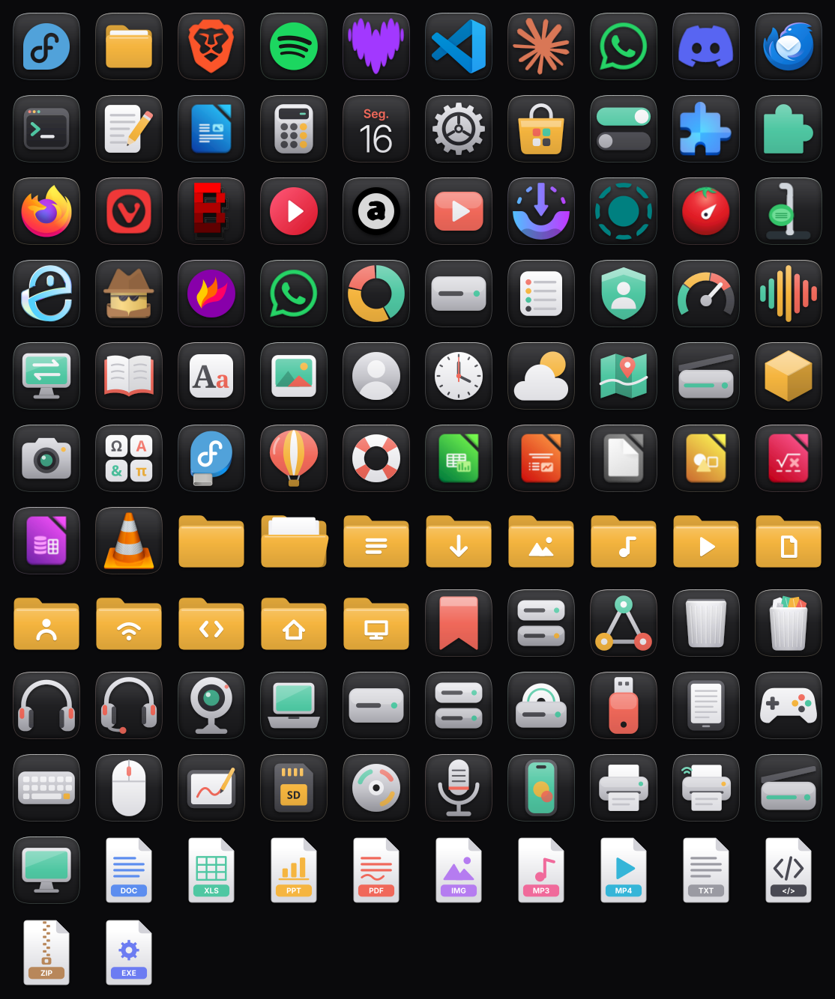

# Brisa

Tema completo para GNOME no Fedora: ícones, GTK 3/GTK 4 (libadwaita) e GNOME
Shell. Estrutura e proporções no estilo do macOS, com identidade própria:
superfícies grafite, vidro escuro e a paleta coral `#F0685A`, âmbar `#F5B53F`
e menta `#4FC7A2`.



- **Ícones:** cada app com o seu logo colorido num tile escuro de vidro
  (superelipse), no mesmo peso visual; pastas no estilo macOS; tipos de arquivo
  como folha dobrada com etiqueta colorida; versões otimizadas de 16 a 256 px.
- **Janelas:** botões redondos à esquerda (fechar, minimizar, maximizar),
  superfícies grafite, cantos arredondados, destaque configurável.
- **GNOME Shell:** painel superior translúcido; menus, menu rápido, calendário,
  notificações, OSD e Alt+Tab em vidro escuro.
- **Sem extensões de terceiros.** Só o tema do Shell precisa da extensão
  oficial User Themes; ícones e GTK funcionam sem nenhuma.

Feito e testado no Fedora 45 com GNOME Shell 51.1, libadwaita 1.10, GTK 4.24 e
GTK 3.24. Os geradores detectam as versões instaladas (veja
[Quando o GNOME mudar de versão](#quando-o-gnome-mudar-de-versão)).

## Estrutura

| Pasta / arquivo | O que tem |
| --- | --- |
| `config.toml` | **Todas as variáveis:** paleta, tamanhos, intensidades, destaque, superfícies, vidro. |
| `icons/` | Gerador de ícones (`gerar.py`), template do tile (`tile.svg`), fontes de cada ícone e desenhos próprios (`glifos.py`), logos do Simple Icons (`fontes/`). |
| `gtk/` | Gerador do tema GTK (`gerar.py`) e os modelos de CSS (`modelos/`). |
| `shell/` | Gerador do tema do GNOME Shell (`gerar.py`) e as sobrescritas (`modelos/brisa.css`). |
| `scripts/` | `install.sh`, `apply.sh`, `revert.sh`, `uninstall.sh`, `preview.py` e as unidades do systemd. |
| `gerar.py` | Atalho para `icons/gerar.py` (é o que o serviço do systemd chama). |

## Ver antes de instalar

```sh
python3 scripts/preview.py
xdg-open preview.html
```

Gera tudo em `build/` (sem tocar no sistema) e abre um preview com quatro abas:
ícones (vários tamanhos e fundos), janelas e GTK (em foco, sem foco, hover,
maximizada), GNOME Shell (painel, menu rápido, calendário, notificação, OSD,
Alt+Tab) e o relatório (de onde veio cada ícone e o que está pendente).

## Instalar e aplicar

Requer Python 3.11+, Pillow (`python3-pillow`), PyGObject com librsvg e pycairo
(tudo já vem no Fedora Workstation). Para o tema do Shell, a extensão oficial
User Themes: `sudo dnf install gnome-shell-extension-user-theme`.

```sh
git clone https://github.com/viniciusbispo19/brisa-icons.git
cd brisa-icons
scripts/install.sh      # gera os arquivos em ~/.local/share (não muda o visual)
scripts/apply.sh        # aplica, guardando o estado atual para o revert
```

Cada parte pode ser instalada e aplicada sozinha com `--fase`:

| Fase | install.sh | apply.sh |
| --- | --- | --- |
| `icones` | ícones em `~/.local/share/icons/Brisa` e o serviço que os mantém atualizados | `icon-theme` |
| `gtk` | tema em `~/.local/share/themes/Brisa/gtk-3.0` e `gtk-4.0` | `gtk-theme`, `color-scheme` e o CSS em `~/.config/gtk-4.0/gtk.css` e `~/.config/gtk-3.0/gtk.css` |
| `botoes` | não precisa | `button-layout` com os botões à esquerda |
| `shell` | tema em `~/.local/share/themes/Brisa/gnome-shell` | habilita a User Themes e define o tema do Shell |

Todos os scripts aceitam `--dry-run` (mostra o que faria) e podem ser rodados
de novo sem efeito colateral. Para os apps Flatpak lerem o CSS do tema, use
`scripts/apply.sh --fase gtk --flatpak`.

O `install.sh --fase icones` também instala um serviço do systemd de usuário:
quando um app é instalado ou removido, os ícones são regerados, e o app novo
entra com o seu logo original no tile; à meia-noite, a data do ícone do
Calendário é atualizada.

## Reverter e desinstalar

```sh
scripts/revert.sh       # volta icon-theme, gtk-theme, color-scheme, button-layout,
                        # o tema do Shell e os CSS de ~/.config ao que eram antes
scripts/uninstall.sh    # remove os arquivos instalados e o serviço
```

O `apply.sh` guarda o estado original em `~/.config/brisa/backup.json` (cada
valor só na primeira vez) e uma cópia dos CSS que já existiam em
`~/.config/brisa/backup/`. O `uninstall.sh` se recusa a rodar com o tema ainda
aplicado; rode o `revert.sh` antes (ou use `--forcar`).

## Trocar a paleta e as variáveis

Tudo fica em `config.toml`. Depois de editar, rode `scripts/install.sh` de novo
(e reabra os apps). Os principais:

| Variável | Efeito |
| --- | --- |
| `[paleta]` | Coral, âmbar, menta e o grafite do tile. |
| `icones.tile_lado`, `icones.avulsos_escala` | Tamanho dos ícones no quadro (120 = margem de 4). |
| `icones.area_alvo`, `icones.lado_maximo` | Peso visual do logo: fração da área do tile ocupada pela silhueta. |
| `icones.tint_rim` | Quanto a borda de luz do tile puxa para a cor do logo (TINT_RIM). |
| `icones.trash_style` | Lixeira `"tile"` ou `"avulsa"` (TRASH_STYLE). |
| `icones.tile` e `icones.tile_pequeno` | Borda, reflexo e sombras nos tamanhos grandes e até 32 px. |
| `icones.etiquetas` | Cor da etiqueta de cada tipo de arquivo. |
| `gtk.accent` | Destaque das janelas (nome da paleta ou hex); o texto sobre ele é escolhido para passar no contraste AA. |
| `gtk.superficies`, `gtk.raio_janela` | Tons de grafite e o raio dos cantos das janelas. |
| `gtk.botoes_janela` | Tamanho, espaço, glifo e cor sem foco dos botões de janela. |
| `shell.*` | Destaque do Shell, opacidade do painel e do vidro, raios. |

Para mudar o desenho e não só os valores:
- **Ícones:** `icons/tile.svg` (tile) e `icons/glifos.py` (de onde vem cada
  ícone: `original`, `simple:<marca>` ou `desenho:<nome>`).
- **GTK:** os modelos em `gtk/modelos/`.
- **Shell:** as sobrescritas em `shell/modelos/brisa.css`.

## Quando o GNOME mudar de versão

Rode `scripts/install.sh` de novo: os três geradores leem o que está instalado.

- **Shell:** `shell/gerar.py` extrai o CSS padrão do `gnome-shell-theme.gresource`
  instalado e só acrescenta as sobrescritas. Ele também confere se toda classe e
  propriedade de `shell/modelos/brisa.css` ainda existe no CSS novo; se o GNOME
  renomear algo, o aviso aparece na saída e no preview, e o ajuste é feito
  nesse arquivo.
- **GTK:** `gtk/gerar.py` valida todo o CSS com o parser do GTK 4 e do GTK 3
  instalados. As cores do libadwaita são as variáveis `:root --*-color` de
  `gtk/modelos/libadwaita.css`; se o libadwaita mudar os nomes, ajuste ali
  (a lista atual sai do `gresource` em `/usr/lib64/libadwaita-1.so.0`). Os temas
  base vêm de `resource:///org/gtk/libgtk/theme/…` em `gtk/modelos/gtk4.css` e
  `gtk3.css`.
- **Ícones:** os nomes vêm do `Icon=` dos `.desktop` instalados e dos nomes do
  Adwaita; app renomeado ou novo entra sozinho com o ícone original.

## Licença

Código e desenhos próprios: MIT, veja [LICENSE](LICENSE). Logos de marca,
Simple Icons e partes geradas a partir do GNOME: veja
[LICENCAS-TERCEIROS.md](LICENCAS-TERCEIROS.md).
